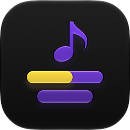
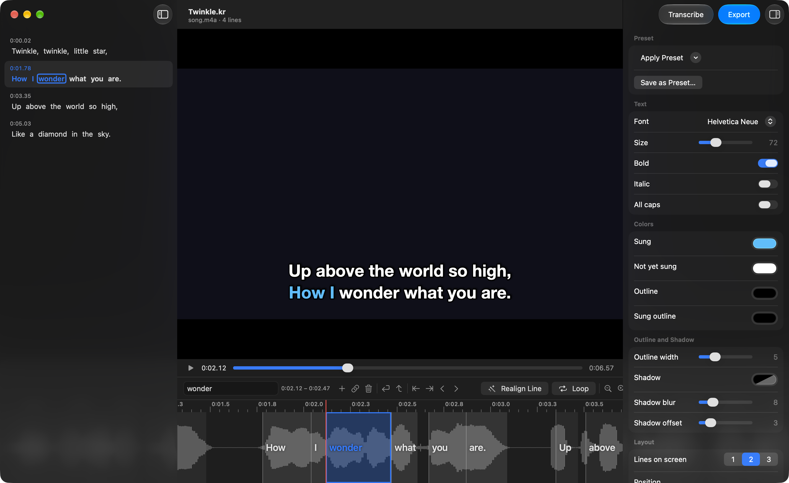

<p align="center">
  
</p>

<h1 align="center">Karaoke Maker</h1>

<p align="center">
  A macOS app that turns a song or a music video into a karaoke video, with lyrics that fill in word by word
  as they are sung.<br>
  Built with SwiftUI on Apple's <a href="https://developer.apple.com/documentation/speech">Speech</a>
  framework and AVFoundation, with optional vocal isolation by
  <a href="https://github.com/adefossez/demucs">Demucs</a> and word timing by Meta's
  <a href="https://github.com/facebookresearch/fairseq/tree/main/examples/mms">MMS</a> forced aligner.
</p>

<p align="center">
  
</p>

## Features

- **Open a song**: drop an audio file (MP3, WAV, M4A…) or a video (MOV, MP4…) on the window or on the Dock
  icon, or choose **File › Choose Video or Audio…** (⇧⌘O). Each song is a `.kr` project that keeps the
  lyrics, their timing and the style; the media stays where it is.
- **Transcribe**: **Transcribe** in the toolbar (⌥⌘T) recognises the lyrics and their timing on this Mac, in
  any language Apple's speech recognition supports. Options in the same sheet:
  - **Lyrics (optional)**: paste the exact lyrics and the timing is mapped onto your text, one karaoke line
    per line of text. Misheard, missing and extra words don't throw the rest off.
  - **Isolate the vocals**: separates the voice from the music with Demucs before listening.
  - **Precise word timing**: finds where each word actually starts and ends in the voice with forced
    alignment, instead of the recogniser's approximate times.
- **Edit the words**: click a word in the lyrics or in the timeline to select it and move the playhead there,
  ⇧-click to select a range, double-click a line to retype it. The bar above the timeline edits the selected
  word: its text, **Add Word After**, **Merge with Next Word**, **Delete Word**, **Start New Line Here**,
  **Move to Previous Line**, **Set Start to Playhead**, **Set End to Playhead**, **Move Earlier** and **Move
  Later** (20 ms).
- **Fix the timing on the timeline**: the whole song on a waveform, with every word as a block. Drag a word
  to move it, drag its edges to change where it starts and ends, and hear the audio at the edge while you
  drag. Drag on the waveform or press ← → (⇧ for bigger steps) to scrub with sound. Zoom with ⌘+ / ⌘−, the
  buttons in the bar or a pinch.
- **Loop and realign**: **Loop** (⌥⌘L) plays the selected words, or the whole line, over and over.
  **Realign Line** (⌥⌘A) times a line again from the voice after you correct its text; **Lyrics › Realign
  All Words** does the whole song.
- **Style**: the inspector sets the font, size, bold, italic, all caps, the four colours (sung, not yet sung
  and their outlines), outline width, shadow, 1 to 3 lines on screen, position, margin, line spacing, a
  smooth or word-by-word fill, how early lines appear, a box behind the lines and the background for audio
  files. Six presets to start from (Classic, Neon, Pop, Minimal, Terminal, Ballad); **Save as Preset…**
  keeps your own. The preview draws exactly what the export will.
- **Export** (⌘E): choose the format in the save panel.
  - **Transparent Overlay**: ProRes 4444 with alpha in a `.mov`, to lay over the video in Final Cut,
    Premiere or DaVinci Resolve.
  - **Video with Lyrics**: H.264 `.mp4` with the lyrics burnt in, ready to play.

  A video keeps its size and frame rate; an audio file becomes 720p, 1080p or 4K at 30 fps on the style's
  background colour. The audio is always included.
- **Two languages**: the interface is in English and Italian, following the system language.

## Requirements

- macOS 26 or later (Apple's `SpeechAnalyzer`, used for the recognition, is new in macOS 26)
- Xcode 26 or later to build
- For **Isolate the vocals** and **Precise word timing** only: Python 3.11 to 3.13 (the installer looks
  for those first; Homebrew's `python@3.12` works). The app installs the rest itself: in **Transcribe**, press
  **Install…** next to "Components not installed". It creates its own environment in
  `~/Library/Application Support/KaraokeMaker/python` and installs Demucs, PyTorch's torchaudio and NumPy
  into it, about 1 GB. On first use the Demucs model and the 1.2 GB alignment model are downloaded too.

Recognition alone needs nothing else: the speech model for a language is downloaded by macOS the first time
you transcribe in it.

## Installation

```bash
git clone https://gitlab.com/giuliomaffei90/karaoke-maker.git
cd karaoke-maker
./build.sh
open "dist/Karaoke Maker.app"
```

[`build.sh`](build.sh) builds the release binary with SwiftPM and assembles `dist/Karaoke Maker.app`: it
copies the alignment script, compiles the Icon Composer icon with `actool`, writes the Info.plist (the
`.kr` document type, and audio and video as files the app can open) and signs the app ad hoc. It passes the
real SDK version to the linker, because SwiftPM would otherwise stamp the binary with the deployment
target's SDK and macOS would draw the app without Liquid Glass.

For development, open `Package.swift` in Xcode, or run the tests with `swift test`. Two tests run only when
asked: `KARAOKE_MEDIA=/path/song.mp4 swift test` recognises and exports a real file, and
`KARAOKE_DEBUG=/path/song.mp3 KARAOKE_LYRICS=/path/lyrics.txt swift test --filter debugAlignment` prints the
recognised and aligned times of every word.

## How it works

1. The media's audio is read with AVFoundation into a 44.1 kHz WAV
   ([`Transcription.swift`](Sources/KaraokeMaker/Transcription.swift)).
2. With **Isolate the vocals**, `python -m demucs --two-stems=vocals` separates the voice; the result is kept
   in `~/Library/Caches/KaraokeMaker/vocals`, so each song is separated once
   ([`Python.swift`](Sources/KaraokeMaker/Python.swift)).
3. `SpeechTranscriber` recognises the words with their time ranges. Without pasted lyrics they become lines
   at pauses, at the end of sentences and when a line passes 32 characters. With pasted lyrics, a word-level
   edit distance pairs your words with the recognised ones and gives them their times.
4. With **Precise word timing**, [`Resources/align.py`](Resources/align.py) runs the MMS forced aligner on a
   16 kHz copy of the voice (or of the whole mix, without vocal isolation): every letter of the lyrics is placed on 20 ms frames, a "star" token between
   lines absorbs what isn't in the lyrics, and each word ends where the voice stops. The script reads a JSON
   job and prints the times; the app runs it with the Python of its environment.
5. [`Renderer.swift`](Sources/KaraokeMaker/Renderer.swift) draws one instant of the lyrics with Core Text:
   lines take turns in their rows, the sung part is clipped over the unsung one, outline and shadow are drawn
   in one layer. The preview calls it every frame; so does the export.
6. [`Exporter.swift`](Sources/KaraokeMaker/Exporter.swift) renders every frame into pixel buffers (over the
   video's own frames, or on a transparent or coloured background) and writes them with `AVAssetWriter`,
   together with the audio re-encoded as AAC.

Projects are binary property lists, so nothing previews them as text; projects saved as JSON by earlier
versions still open.

## Known limitations

- The recogniser's own timing is approximate on singing over music, often by several tenths of a second.
  **Precise word timing** fixes it but needs the Python components.
- The forced aligner only knows letters: words made only of numbers or symbols keep the recogniser's times.
- The app looks for an existing Python with Demucs through your login shell's `PATH` and pip's usual
  folders; an install anywhere else is found only through the app's own **Install…**.
- A project points to its media by path: if the file is moved, the project asks for it again.
- When the timeline is zoomed out, the labels of short words overlap; zoom in to read them.
- **Transcribe** replaces the lyrics already in the project.
